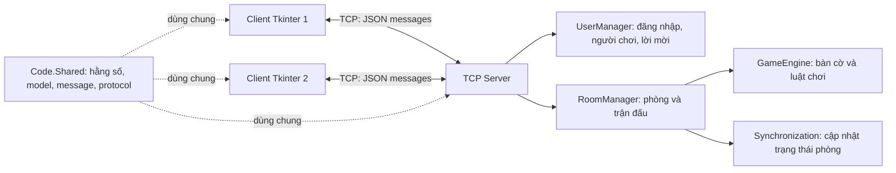

# UDM_16 - Game Caro trực tuyến

## 1. Thông tin đề tài

**Môn học:** Lập trình mạng  
**Nhóm:** NET_262701303_03  
**Tên đề tài:** Game Caro trực tuyến  
**Mã đề tài:** UDM_16

## 2. Danh sách thành viên

| STT | Họ và tên | MSSV |
| ---: | --- | --- |
| 1 | Lê Văn Khải | 051206008834 |
| 2 | Trần Nguyễn Hoàng Minh | 083206001369 |
| 3 | Phạm Minh Hiếu | 054206004641 |
| 4 | Trần Quang Huy | 054206009272 |
| 5 | Trần Gia Khiêm | 054206009756 |
| 6 | Lê Minh Như | 077306006704 |

## 3. Giới thiệu đề tài

Game Caro Online là trò chơi Caro trên bàn cờ 15x15, được xây dựng theo mô hình Client-Server bằng Python. Người chơi kết nối tới server, đăng nhập, tạo hoặc tham gia phòng và lần lượt đánh X/O. Server quản lý người chơi và phòng đấu, kiểm tra nước đi, đồng bộ trạng thái bàn cờ tới các client trong phòng, đồng thời xử lý các tình huống ngắt kết nối.

## 4. Công nghệ sử dụng

- Python.
- Tkinter cho giao diện đồ họa.
- TCP Socket cho kết nối Client-Server.
- Threading để xử lý kết nối mạng đồng thời.
- JSON cho nội dung thông điệp; giao thức đóng khung độ dài được định nghĩa trong dự án.

Phiên bản Python tối thiểu chưa được khai báo trong cấu hình dự án. `requirements.txt` hiện chỉ có `pytest`, phục vụ kiểm thử.

## 5. Kiến trúc hệ thống

Ứng dụng gồm client giao diện Tkinter, TCP server và các thành phần dùng chung. Client gửi thông điệp JSON có đóng khung qua TCP; server xử lý mỗi kết nối riêng, quản lý trạng thái tập trung và gửi cập nhật phòng tới hai người chơi. Client hiển thị trạng thái nhận từ server thay vì tự quyết định kết quả trận đấu.



Giao thức trong `Code/Shared/protocol.py` mã hóa mỗi thông điệp thành JSON UTF-8, có tiền tố độ dài 4 byte theo thứ tự byte mạng. Kích thước payload tối đa là 1 MiB. Các cập nhật phòng có phiên bản tăng dần và được gửi từ server tới những người chơi trong phòng.

### Cấu trúc project

```text
Code/
	Client/    Giao diện Tkinter, điều phối ứng dụng và TCP client nền
	Server/    TCP server, quản lý người dùng/phòng và luật trận đấu
	Shared/    Hằng số, model, kiểu thông điệp và giao thức dùng chung
tests/       Unit test, integration test và kiểm thử kết nối
README.md    Tài liệu dự án
requirements.txt
```

## 6. Chức năng chính

Các chức năng dưới đây được đối chiếu với mã nguồn hiện tại:

- Kết nối client-server, gửi/nhận thông điệp; xử lý dữ liệu giao thức không hợp lệ, timeout và ngắt kết nối.
- Đăng nhập bằng tên người chơi, hiển thị danh sách người đang trực tuyến, gửi và phản hồi lời mời.
- Tạo, xem danh sách, tham gia và rời phòng. Mỗi phòng nhận tối đa hai người; người tạo phòng là X, người tham gia là O. Chủ phòng bắt đầu trận khi đã có đủ hai người.
- Hiển thị bàn cờ, lượt đi và kết quả; server xác thực nước đi, kiểm tra thắng/hòa và gửi trạng thái phòng tới client.
- Giao diện có màn hình đăng nhập, sảnh chờ, phòng đấu và bàn cờ; có thông báo trạng thái, lỗi, lời mời và kết quả trận đấu.
- Token kết nối lại được cấp khi đăng nhập; người chơi có tối đa 60 giây để kết nối lại. Trận đang đấu được tạm dừng và khôi phục bàn cờ, lượt đi, lịch sử cùng thời gian còn lại; quá thời hạn thì đối thủ thắng do `DISCONNECT_TIMEOUT`.
- Mỗi lượt có 30 giây do server quản lý. Hết giờ thì đối thủ thắng với lý do `TIMEOUT`; reconnect tạm dừng và tiếp tục đồng hồ còn lại.
- Cho phép tối đa 10 khán giả mỗi phòng. Khán giả nhận trạng thái đồng bộ, lịch sử và tin nhắn nhưng không thể đánh cờ, bắt đầu trận, đầu hàng hoặc chơi lại với tư cách người chơi.
- Server lưu lịch sử từng nước đi hợp lệ (số lượt trong ván, người chơi, quân, tọa độ 0-based và thời điểm UTC). Client có danh sách nước đi và xem lại bàn cờ tại mốc đã chọn.
- Mỗi ván đã kết thúc được lưu bền vững trong SQLite, gồm người chơi, kết quả, lý do kết thúc và lịch sử các nước đi. Dữ liệu vẫn còn sau khi khởi động lại server.
- Chat trong phòng giới hạn 500 ký tự mỗi tin nhắn. Người chơi có thể đầu hàng; hai người chơi phải cùng đồng ý mới bắt đầu ván mới.
- Danh sách phòng thể hiện trạng thái, chủ phòng, số người chơi và số khán giả; có thể xem phòng đang chờ, đang đấu hoặc đã kết thúc nếu phòng còn trong bộ nhớ.
- Trạng thái phòng đang chờ/đang diễn ra, token kết nối lại và chat vẫn chỉ lưu trong bộ nhớ server; không thể khôi phục một phòng đang đấu sau khi server khởi động lại. Chỉ kết quả và lịch sử của các ván đã kết thúc được lưu bền vững trong SQLite.

## 7. Phân công công việc thành viên

Phân công dưới đây được tổng hợp theo tài liệu công việc của nhóm. Đây là phạm vi mỗi thành viên cần phụ trách, không phải xác nhận rằng mọi chức năng đã hoàn thành.

### Thành viên 1 - Lê Văn Khải (Network & Protocol)

- Xây dựng phần kết nối TCP giữa Client và Server.
- Định nghĩa giao thức, cấu trúc message và quy trình gửi/nhận thông điệp.
- Xử lý timeout, ngắt kết nối và lỗi giao tiếp.

### Thành viên 2 - Trần Nguyễn Hoàng Minh (User & Lobby)

- Xây dựng chức năng người chơi và đăng nhập.
- Quản lý trạng thái người chơi và danh sách người đang trực tuyến.
- Xây dựng chức năng lời mời đấu, chấp nhận và từ chối lời mời.

### Thành viên 3 - Phạm Minh Hiếu (Room & Match)

- Xây dựng chức năng tạo, tham gia và rời phòng; hiển thị danh sách phòng.
- Quản lý trạng thái phòng và phân chia quân X/O.
- Phụ trách luồng người xem (Spectator) trong phạm vi quản lý phòng/trận.

### Thành viên 4 - Trần Quang Huy (Game Engine)

- Xây dựng bàn cờ, nước đi và quản lý lượt chơi.
- Kiểm tra tính hợp lệ của nước đi.
- Xử lý điều kiện thắng, thua, hòa, đồng hồ trận đấu và kết quả.

### Thành viên 5 - Trần Gia Khiêm (Synchronization)

- Xây dựng trạng thái trận đấu và cơ chế đồng bộ.
- Phát tán (broadcast) cập nhật trận đấu đến các Client.
- Phụ trách đồng bộ cho người xem, kết nối lại và lịch sử nước đi.

### Thành viên 6 - Lê Minh Như (GUI & Testing)

- Xây dựng giao diện đăng nhập, sảnh chờ, phòng đấu và bàn cờ.
- Hiển thị trạng thái kết nối và trạng thái trận đấu trên giao diện.
- Thực hiện kiểm thử chức năng, trường hợp dữ liệu không hợp lệ, kiểm thử tải và hiệu năng.

## 8. Yêu cầu môi trường

- Python: dự án chưa khai báo phiên bản tối thiểu/tối đa được hỗ trợ. Môi trường Python đi kèm workspace hiện tại là 3.14.0; điều này không xác nhận tương thích với các phiên bản khác.
- Giao diện cần Tkinter, thuộc thư viện chuẩn Python. Trên một số bản phân phối Linux, Tkinter có thể cần được cài qua trình quản lý gói hệ thống.
- `requirements.txt` chỉ khai báo `pytest>=8.0.0`, dùng để chạy kiểm thử. Mã ứng dụng sử dụng Tkinter và các thư viện chuẩn Python, không khai báo thêm gói pip runtime.

## 9. Cấu hình

Server nhận các tham số dòng lệnh sau:

| Tham số | Mặc định | Ý nghĩa |
| --- | --- | --- |
| `--host` | `127.0.0.1` | Địa chỉ giao diện mạng server bind vào |
| `--port` | `12345` | Cổng TCP server lắng nghe |
| `--client-timeout` | `60.0` giây | Thời gian chờ client không hoạt động trước khi đóng kết nối |
| `--database` | `caro_history.sqlite3` | Đường dẫn file SQLite lưu kết quả và lịch sử ván đã kết thúc |

Các giá trị mặc định được định nghĩa trong `Code/Shared/constants.py` và `Code/Server/main.py`. Server cho phép cấu hình cổng từ 0 đến 65535; màn hình client yêu cầu cổng từ 1 đến 65535. Client mặc định dùng `127.0.0.1:12345`, đồng thời cho phép nhập địa chỉ server và cổng trên màn hình đăng nhập.

Giới hạn tính năng hiện tại: mỗi lượt đánh tối đa 30 giây, cửa sổ kết nối lại 60 giây, tối đa 10 khán giả mỗi phòng và chat tối đa 500 ký tự mỗi tin. Thời gian do server quyết định; đồng hồ hiển thị trên client chỉ mang tính hiển thị. Token reconnect chỉ được giữ trong bộ nhớ client và mất khi ứng dụng client đóng.

Để các máy khác trong mạng truy cập, có thể bind server vào các giao diện mạng bằng `--host 0.0.0.0`, sau đó nhập địa chỉ IP LAN của máy server trên client. `0.0.0.0` là địa chỉ bind phía server, không phải địa chỉ để client kết nối. Cần đảm bảo firewall và mạng cho phép kết nối tới cổng đã chọn.

Tên đăng nhập được server chấp nhận khi dài 3-20 ký tự, bắt đầu và kết thúc bằng chữ cái hoặc chữ số, và chỉ chứa chữ cái, chữ số, dấu gạch dưới hoặc gạch nối. Tên đang trực tuyến không thể được dùng lại.

## 10. Cài đặt và chạy ứng dụng

Từ thư mục gốc dự án, tạo và kích hoạt môi trường ảo (khuyến nghị):

```powershell
python -m venv .venv
.\.venv\Scripts\Activate.ps1
```

Trên macOS/Linux, lệnh kích hoạt là:

```sh
source .venv/bin/activate
```

Cài công cụ kiểm thử được khai báo trong requirements:

```sh
python -m pip install -r requirements.txt
```

Mở terminal thứ nhất và chạy server:

```sh
python -m Code.Server.main
```

Hoặc chỉ định rõ host, port và timeout:

```sh
python -m Code.Server.main --host 127.0.0.1 --port 12345 --client-timeout 60
```

Có thể chỉ định vị trí file lịch sử bằng `--database`, ví dụ:

```powershell
python -m Code.Server.main --database data\caro_history.sqlite3
```

Mở terminal thứ hai và chạy client:

```sh
python -m Code.Client.main
```

Nhập tên người chơi, địa chỉ server và cổng trên màn hình đăng nhập. Để chơi, mở client thứ hai kết nối cùng server; một người tạo phòng, người còn lại tham gia, sau đó chủ phòng bắt đầu trận. Client khác có thể chọn xem phòng để làm khán giả. Trong phòng, người chơi và khán giả có thể chat; người chơi có thể đầu hàng hoặc đề nghị chơi lại sau khi ván kết thúc. Có thể chạy nhiều client, nhưng mỗi phòng chỉ có hai ghế người chơi và tối đa 10 khán giả. Nếu mất mạng, client tự thử kết nối lại trong cửa sổ 60 giây khi server vẫn hoạt động. Dừng server bằng `Ctrl+C`.

## 11. Kiểm thử

Chạy toàn bộ test:

```sh
python -m pytest -q
```

### TCP server smoke test

Test sau khởi chạy hai client kiểm thử đồng thời, gửi heartbeat theo giao thức đóng khung và kiểm tra lỗi giao thức, timeout cùng quá trình dừng an toàn:

```sh
python -m pytest -q tests/test_protocol.py tests/test_server_network.py
```

Có thể kiểm tra thủ công bằng cách khởi chạy server, sau đó mở hai terminal Python riêng và chạy đoạn mã sau trong mỗi terminal:

```python
import socket
from Code.Shared.protocol import MessageProtocol

client = socket.create_connection(("127.0.0.1", 12345))
MessageProtocol.send_message(client, {"type": "HEARTBEAT"})
```

Server ghi log kết nối và loại thông điệp nhận được. Gọi `client.close()` trong mỗi terminal client; dừng server bằng `Ctrl+C`.

## 12. Luật chơi

- Bàn cờ có kích thước 15x15.
- Hai người chơi luân phiên đánh X và O.
- Người đầu tiên tạo được ít nhất 5 quân liên tiếp theo hàng ngang, hàng dọc hoặc đường chéo sẽ thắng.
- Bàn cờ đầy mà không có người thắng thì ván đấu hòa.
- Không thể đánh vào ô đã có quân hoặc thực hiện nước đi không hợp lệ.

## 13. Trạng thái trận đấu

| Trạng thái | Ý nghĩa |
| --- | --- |
| `IN_PROGRESS` | Trận đấu đang diễn ra |
| `X_WON` | Người chơi X thắng |
| `O_WON` | Người chơi O thắng |
| `DRAW` | Trận đấu kết thúc hòa |